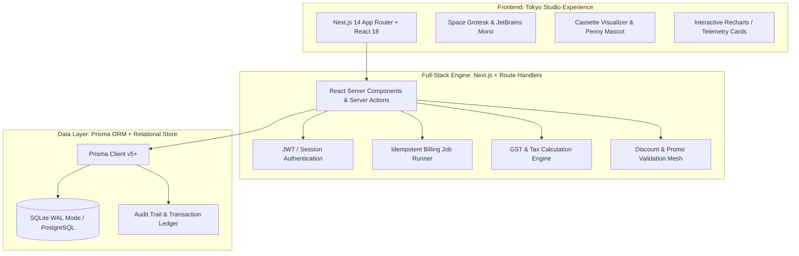

# BRIGHTLOOP — Subscription Management System
> **Unified B2B Subscription Lifecycle, Automated Billing Engine & Financial Intelligence Platform**  
> *Developed for the Odoo Hackathon Challenge · Tokyo Studio Minimalist Aesthetic*

---

## 1. Executive Summary

**Brightloop** is a next-generation subscription management platform engineered to serve as the mission-critical digital backbone for recurring revenue businesses. Built in response to the **Odoo Subscription Management System Hackathon Problem Statement**, Brightloop eliminates spreadsheet errors, manual billing friction, missed renewals, and financial opacity.

The platform bridges the entire lifecycle of recurring commerce:
$$\text{Product Catalog} \longrightarrow \text{Plan Configuration} \longrightarrow \text{Customer Onboarding} \longrightarrow \text{Quotation} \longrightarrow \text{Subscription Activation} \longrightarrow \text{Automated Billing} \longrightarrow \text{Invoice Generation} \longrightarrow \text{Payment Reconciliation} \longrightarrow \text{Revenue Telemetry}$$

Brightloop pairs a **Tokyo Studio Minimalist UI** (Space Grotesk typography, calm porcelain `#F8FAF9` canvas, tactile cassette visualizers, and deep sage teal `#2F7D72` accents) with a robust full-stack **Next.js 14 + TypeScript + Prisma** architecture capable of sub-2-second response times even under enterprise subscriber volume.

---

## 2. Engineering Team

| Team Member | GitHub Username | Email |
| :--- | :--- | :--- |
| **Advaith Sreejith Pillai** (Lead) | [`advaithspillai3009`](https://github.com/advaithspillai3009) | `advaith.ec2529@saintgits.org` |
| **Ashwin Girish** | [`ashwingirish2007`](https://github.com/ashwingirish2007) | `ashwingirish2007@gmail.com` |
| **Nikhil Sekhar.** | [`Nikhil-c-bit`](https://github.com/Nikhil-c-bit) | `nikhils.rbb2529@saintgits.org` |
| **Adharsh D. Nair** | [`adharshdnair068-bot`](https://github.com/adharshdnair068-bot) | `adharshdnair068@gmail.com` |

---

## 3. Core Capabilities & Problem Statement Alignment

| Problem Statement Scene | Today at Brightloop (Pain Point) | Brightloop Platform Solution | Implementation Module |
| :--- | :--- | :--- | :--- |
| **A New Customer Signs Up** | Spreadsheets, fragmented auth, no access boundaries | Multi-role secure auth (Admin, Staff, Customer), strict password criteria (>8 chars, uppercase, lowercase, special char), self-service portal | [User Roles & Permissions](docs/USER_ROLES_AND_PERMISSIONS.md) |
| **Launching a New Plan** | Ad-hoc pricing, lost add-on revenue | Multi-frequency plans (Daily, Weekly, Monthly, Yearly), product variants with price adjustments (e.g. Odoo brand +₹560), custom end/pause/renewal rules | [Requirements](docs/REQUIREMENTS.md) |
| **Turning a Quote into a Subscription** | Quotes drafted manually from scratch in documents | Reusable quotation templates with validity windows, automated tax & line calculations, 1-click conversion to active subscription | [Billing Workflow](docs/API_AND_BACKEND_DESIGN.md) |
| **Billing Day** | Hundreds typed by hand; errors, duplicate billing | Idempotent automated recurring billing scheduler, prefilled taxes and product lines, duplicate billing prevention locks | [System Architecture](docs/SYSTEM_ARCHITECTURE.md) |
| **A Customer Asks for a Better Price** | Untracked manual discounts, forgotten expirations | Rule-based discount engine (fixed or %, min purchase/qty, validity dates, global or product-specific limits) | [Database Design](docs/DATABASE_DESIGN.md) |
| **The Money Comes In** | Scrolling bank statements, untracked partials | Multi-method payment tracking, automated invoice matching, paid/overdue status, dunning alerts | [API & Backend](docs/API_AND_BACKEND_DESIGN.md) |
| **The Finance Lead at Month-End** | Days spent aggregating spreadsheets | Unified Intelligence Center: live MRR, ARR, Cash Collected vs. Contracted, churn, aging invoices, sub-2s telemetry | [Unique Solution](docs/UNIQUE_SOLUTION.md) |

---

## 4. The Hackathon Differentiators

Brightloop stands out from generic CRUD dashboards through three integrated innovations:

1. **Brightloop Financial Intelligence Center & Visual Billing Pipeline**
   - A Kanban-style visual pipeline representing billing lifecycle phases: *Due for Billing $\rightarrow$ Invoices Generated $\rightarrow$ Awaiting Confirmation $\rightarrow$ Payments Received $\rightarrow$ Overdue Dunning*.
   - Zero-duplicate-billing guarantee powered by database constraint keys (`subscription_id` + `billing_period_start`).
2. **Smart Recurring Revenue Forecasting Engine**
   - Rigorously distinguishes **Actual Collected Cash** from **Contracted MRR/ARR** and **Pending/Overdue Exposure**.
   - Cohort-based renewal prediction with confidence indicators.
3. **Penny The Financial Mascot & Contextual Assistant**
   - The interactive orange coin mascot brought to life with contextual guidance, explaining tax calculations, alerting to approaching discount expirations, and warning when accounts enter grace periods.

See full details in [docs/UNIQUE_SOLUTION.md](docs/UNIQUE_SOLUTION.md) and [docs/PENNY_MASCOT.md](docs/PENNY_MASCOT.md).

---

## 5. Technology Stack Architecture

Brightloop leverages a unified, modern TypeScript web stack:

- **Frontend**: Next.js 14 App Router with React 18, Tailwind CSS, Space Grotesk typography matching Stitch assets, responsive layouts, and interactive telemetry.
- **Backend**: Next.js Route Handlers and Server Actions with TypeScript, automated validation, and idempotent billing workers.
- **Database**: Relational SQLite / PostgreSQL managed via Prisma ORM with foreign key enforcement, compound indexes for sub-2s query latency, and financial transaction locks.
- **Document Generation**: GST-compliant printable invoice generator and GSTR-1 compatible data ledger.

---

## 6. Technical Documentation Sitemap

- **[docs/PROJECT_OVERVIEW.md](docs/PROJECT_OVERVIEW.md)**: Product vision, user personas, problem analysis, and high-level technical scope.
- **[docs/REQUIREMENTS.md](docs/REQUIREMENTS.md)**: Exhaustive functional & non-functional requirements extracted from the Odoo brief.
- **[docs/REQUIREMENTS_TRACEABILITY.md](docs/REQUIREMENTS_TRACEABILITY.md)**: Matrix linking each business requirement to its database table, API route, frontend view, and test case.
- **[docs/SYSTEM_ARCHITECTURE.md](docs/SYSTEM_ARCHITECTURE.md)**: Architectural diagrams, data flow, component boundaries, and background job topology.
- **[docs/DATABASE_DESIGN.md](docs/DATABASE_DESIGN.md)**: Relational schema specifications, data types, indexes, foreign keys, and audit logging.
- **[docs/ER_DIAGRAM.md](docs/ER_DIAGRAM.md)**: Complete Mermaid Entity-Relationship diagram illustrating all 15 core entities.
- **[docs/API_AND_BACKEND_DESIGN.md](docs/API_AND_BACKEND_DESIGN.md)**: RESTful API contracts, request/response schemas, status codes, and error formats.
- **[docs/UI_UX_IMPLEMENTATION.md](docs/UI_UX_IMPLEMENTATION.md)**: Detailed mapping of Google Stitch assets, Tokyo Studio tokens, cassette visualizer, and responsive views.
- **[docs/USER_ROLES_AND_PERMISSIONS.md](docs/USER_ROLES_AND_PERMISSIONS.md)**: Role-Based Access Control (RBAC) matrix for Admin, Staff, and Customer.
- **[docs/UNIQUE_SOLUTION.md](docs/UNIQUE_SOLUTION.md)**: Deep dive into the Intelligence Center, Revenue Forecaster, and Billing Pipeline.
- **[docs/PENNY_MASCOT.md](docs/PENNY_MASCOT.md)**: Design, animations, and contextual state machine for Penny the mascot.
- **[docs/DEVELOPMENT_ROADMAP.md](docs/DEVELOPMENT_ROADMAP.md)**: Phased implementation milestones, Git commit cadence, and deliverables.
- **[docs/TESTING_STRATEGY.md](docs/TESTING_STRATEGY.md)**: Unit, integration, idempotent billing, and load testing plans.
- **[docs/SETUP_AND_INSTALLATION.md](docs/SETUP_AND_INSTALLATION.md)**: Local developer setup, environment variables, seed scripts, and execution guide.
- **[docs/HACKATHON_DEMO_PLAN.md](docs/HACKATHON_DEMO_PLAN.md)**: 5-minute judge demo script, interactive workflows, and seed data scenarios.
- **[CHANGELOG.md](CHANGELOG.md)**: Commit history, milestone records, and architectural versioning.

---

## 7. License & Attribution

Designed and engineered for the **Odoo Subscription Management System Hackathon**.  
© 2026 Brightloop Software Team. All rights reserved.
