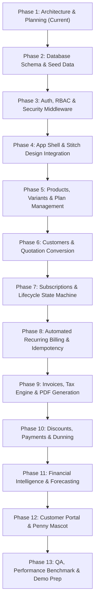

# DEVELOPMENT ROADMAP & MILESTONES
## Brightloop – Phased Implementation Timeline

---

## 1. Phased Development Methodology

Brightloop is developed in controlled, sequential phases to guarantee architectural integrity, complete requirements coverage, and verifiable progress. Work proceeds from data foundations up through core domain services, design integration, and unique differentiator polish.

---

## 2. Milestone Deliverables & Acceptance Criteria

### Milestone 1: Architecture, Documentation & Approval (Current Phase)
- **Deliverables**: Comprehensive technical documentation suite (16 markdown files), initial GitHub push verification, review with user.
- **Acceptance Criteria**: 100% requirements mapped; explicit user sign-off obtained before writing application code.

### Milestone 2: Relational Data Layer & Core Domain Models
- **Deliverables**: SQLAlchemy 2.0 models for all 15 entities; foreign keys, compound indexes, and database initialization script with rich Indian SaaS seed data (Razorpay, Zenith Logistics, Indus FinTech, HyperLocal).
- **Acceptance Criteria**: SQLite database initializes cleanly; WAL mode verified; compound uniqueness constraints active.

### Milestone 3: Authentication, Security & RBAC Middleware
- **Deliverables**: User registration with strict password validation (>8 chars, uppercase, lowercase, special char); bcrypt password hashing; session/JWT management; role-based access dependencies (`admin`, `staff`, `customer`).
- **Acceptance Criteria**: Unauthorized requests return `401`/`403`; passwords safely hashed; customer tenant boundaries enforced.

### Milestone 4: Application Shell & Google Stitch Design Integration
- **Deliverables**: Master UI container implementing the Tokyo Studio Minimalist aesthetic; Space Grotesk typography; `#F8FAF9` canvas; tactile Cassette theme switcher (`SIDE A` / `SIDE B`); responsive sub-navigation rail.
- **Acceptance Criteria**: Pixel-perfect fidelity with downloaded Stitch files; responsive layouts across Desktop, Tablet, and Mobile.

### Milestone 5: Products, Variants & Plan Configuration
- **Deliverables**: Product CRUD with category typing; additive variant price offsets (demonstrating **Odoo Brand +₹560**); Plan builder supporting Daily, Weekly, Monthly, and Yearly cadences with auto-close rules.
- **Acceptance Criteria**: Products and plans persist with correct pricing offsets; minimum quantity rules enforced.

### Milestone 6: Customers & Quotations Engine
- **Deliverables**: Customer directory with search and GSTIN capture; quotation templates; quote proposal generator with validity countdown; 1-click subscription conversion.
- **Acceptance Criteria**: Quotation converts seamlessly into a confirmed subscription without duplicate line entry.

### Milestone 7: Subscription Lifecycle & State Machine
- **Deliverables**: Subscriptions ledger; immutable state machine transitions (**Draft $\rightarrow$ Quotation $\rightarrow$ Confirmed $\rightarrow$ Active $\rightarrow$ Closed**); pause, resume, renew, and early close controls; audit logging.
- **Acceptance Criteria**: Lifecycle actions update status and timestamps accurately; audit trail records user identity.

### Milestone 8: Automated Recurring Billing & Idempotency Safeguards
- **Deliverables**: Billing scheduler service; batch billing run trigger; compound unique key enforcement (`subscription_id` + `billing_period_start`).
- **Acceptance Criteria**: Subscriptions due for billing generate draft invoices; re-triggering billing run detects lock and safely rejects duplicate invoice creation.

### Milestone 9: Invoices, GST Tax Engine & ReportLab PDF Generation
- **Deliverables**: Invoice management ledger; line item calculation engine applying consistent GST tax rules; ReportLab vector PDF generator producing official printable tax invoices.
- **Acceptance Criteria**: Invoices advance through Draft $\rightarrow$ Confirmed $\rightarrow$ Paid; PDF invoices render instantly with accurate math.

### Milestone 10: Discount Rules, Payments & Dunning Mesh
- **Deliverables**: Admin discount rule engine (percentage/fixed, minimum order, usage limits, auto-stop on expiry); payment recording against invoices (full & partial); overdue flagging and dunning notifications.
- **Acceptance Criteria**: Discounts apply automatically to eligible invoices; payments update outstanding invoice balance; partial payments correctly tracked.

### Milestone 11: Financial Intelligence Center & Smart Forecasting
- **Deliverables**: Live executive telemetry ribbon (MRR, ARR, Cash, Overdue); visual Billing Pipeline Kanban; separation of Cash Collected vs. Contracted Run-Rate vs. Overdue Exposure.
- **Acceptance Criteria**: Telemetry queries execute in $< 15\text{ms}$; visual pipeline reflects live database records.

### Milestone 12: Customer Self-Service Portal & Penny Mascot
- **Deliverables**: Isolated Customer Portal for company clients; invoice history and 1-click PDF download; animated Penny Mascot state machine providing contextual insights.
- **Acceptance Criteria**: Customer cannot see other tenants' records; Penny responds dynamically to database events.

### Milestone 13: QA, Performance Verification & Hackathon Polish
- **Deliverables**: Automated test suite (unit, integration, load); latency benchmark proving $< 2.0\text{s}$ target; demo script and presentation checklist.
- **Acceptance Criteria**: All tests pass; zero console errors; smooth 5-minute presentation rehearsal.

---

## 3. Hourly Git Commit Cadence & Source Control Protocol

To comply with the project brief's strict source control standards:
- **Cadence**: Work will be committed and pushed to GitHub approximately every **one hour of active development** and at major milestone completions.
- **Pre-Push Quality Gate**:
  1. Review `git diff` for unintended modifications or stray files.
  2. Verify that no secrets, credentials, or `.env` files are tracked.
  3. Update `CHANGELOG.md` with completed deliverables.
  4. Execute test suite to confirm zero regressions.
  5. Commit with conventional commit messages (`feat: ...`, `fix: ...`, `docs: ...`, `test: ...`).
  6. Push to remote repository on branch `main` and verify commit SHA.

