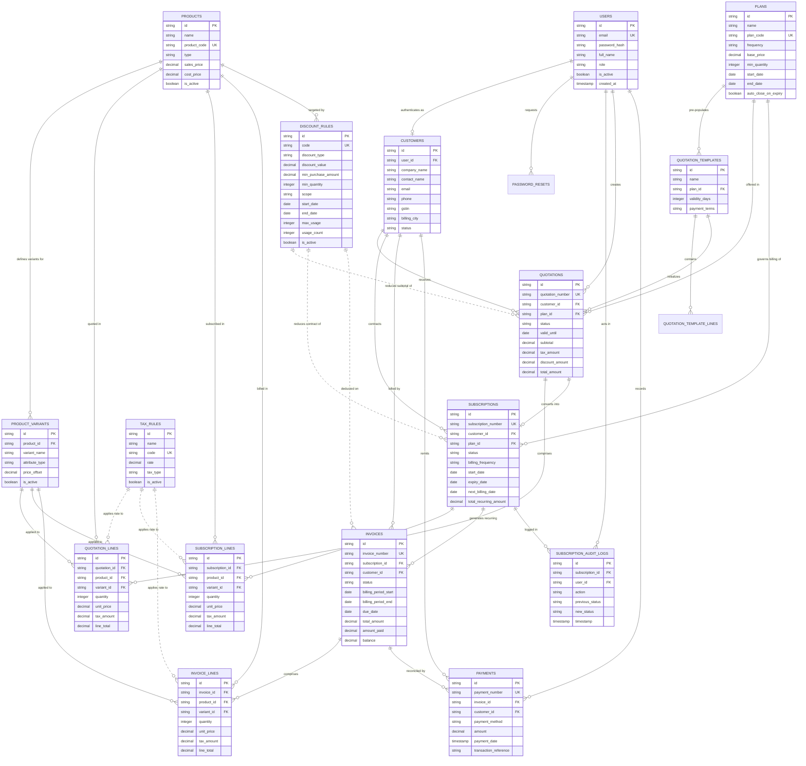

# ENTITY RELATIONSHIP (ER) DIAGRAM
## Brightloop – Subscription Management System

---

## 1. High-Level Entity Relationship Topology

The diagram below maps all core relational entities within Brightloop, including foreign keys, cardinalities, and field types.

---

## 2. Relational Cardinalities & Business Rules

1. **User to Customer (1 : 0..1)**:
   - A `user` with role `customer` maps to exactly one `customer` profile.
   - Staff and Admin users have `user_id` in users without an attached customer profile.
2. **Product to Variant (1 : N)**:
   - Base products can have zero or more variants. Each variant specifies an additive price adjustment (`price_offset`).
   - Selecting a variant automatically combines base product price + offset.
3. **Quotation to Subscription (0..1 : 1)**:
   - A quotation can convert into exactly one subscription. 
   - A subscription can also be directly spawned by Staff without an initial formal quote if an immediate contract is deployed.
4. **Subscription to Invoices (1 : N)**:
   - A subscription generates an ongoing series of recurring invoices over its lifetime.
   - The compound constraint `(subscription_id, billing_period_start)` guarantees that for any specific billing interval, exactly one invoice can exist.
5. **Invoice to Payments (1 : N)**:
   - An invoice can be reconciled across multiple payments (partial payments allowed).
   - Once the sum of payments equals or exceeds `invoices.total_amount`, the invoice transitions to `Paid`.

