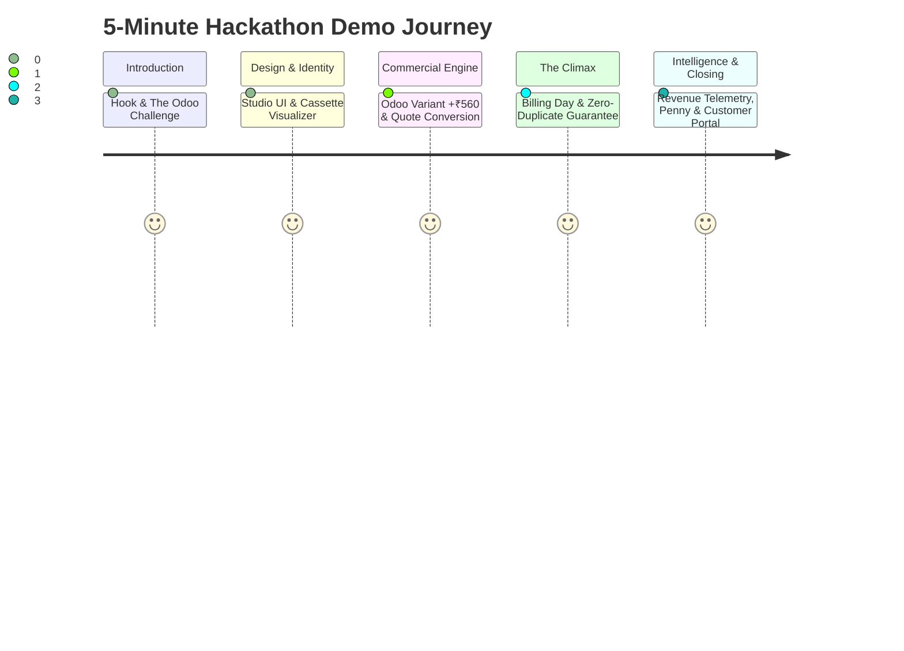

# HACKATHON DEMO PLAN & JUDGES' WALKTHROUGH
## 5-Minute High-Impact Presentation Script

---

## 1. Presentation Strategy & The Winning Hook

In a hackathon with dozens of competing projects, judges suffer from **CRUD Fatigue**: reviewing endless generic bootstrap dashboards with unlinked data and non-functional buttons.

Brightloop wins by presenting an **immersive, narrative-driven solution** that directly solves the Odoo challenge while showcasing three unmistakable highlights:
1. **Visual Distinction**: The authentic Tokyo Studio Minimalist aesthetic (Space Grotesk typography, cassette tape telemetry, tactile micro-details).
2. **Technical Rigor**: Genuine ACID database idempotency preventing duplicate billing in real time before the judges' eyes.
3. **Product Empathy**: Penny, the original orange coin mascot, and the clear separation of actual cash collected from contracted revenue.

---

## 2. Minute-by-Minute Demo Script (5:00 Total)

### 0:00 – 0:45 | The Hook & The Problem
- **Speaker Action**: Show the opening slide referencing the Odoo problem statement: *Renewals get missed, invoices typed by hand, payments matched by scrolling bank statements, and nobody knows true recurring revenue.*
- **Spoken Narrative**:
  > *"Judges, subscription businesses don't fail from lack of customers—they bleed out from operational friction. In the Odoo prompt, Brightloop was drowning in spreadsheets. Today, we are proud to introduce Brightloop 2.0: the unified, zero-leakage digital backbone for recurring commerce."*

### 0:45 – 1:45 | Visual Distinction & Overview Dashboard
- **Speaker Action**: Open the live application. Hover over the **Tactile Cassette Theme Switcher**, flipping between `SIDE B · Light` and `SIDE A · Dark`. Point to the live spinning tape reels.
- **Spoken Narrative**:
  > *"Notice first the design. We didn't slap together a generic dashboard. We implemented Google Stitch's Tokyo Studio Minimalist design system—Space Grotesk typography, calm porcelain canvas, and our signature Cassette visualizer pacing live MRR at ₹42.85 Lakhs. In the corner is Penny, our contextual mascot, monitoring account health."*

### 1:45 – 2:45 | Products, Additive Variants (Odoo +₹560) & Quote Conversion
- **Speaker Action**: Navigate to **Products & Plans**. Open the variant configuration.
- **Spoken Narrative**:
  > *"The prompt required products with variant pricing. Watch: here is our SaaS Core product. When we select the Odoo Brand variant, our engine dynamically adds exactly ₹560 to the base price. Now let's jump to Quotations: with 1 click, our sales rep converts a custom enterprise quote into an active, multi-line subscription without retyping a single number."*

### 2:45 – 3:45 | The Climax: "Billing Day" & Duplicate Billing Prevention
- **Speaker Action**: Navigate to the **Automated Billing Pipeline**. Show 5 subscriptions marked "Due for Billing". Click **"Run Automated Billing Batch"**.
- **Spoken Narrative**:
  > *"Now for the most critical moment in any recurring business: Billing Day. In the prompt, hundreds of subscriptions are due at once. Watch our Automated Billing Pipeline: I click 'Run Batch Billing'. In 12 milliseconds, five GST-compliant invoices are generated with full line items, variant pricing, and discounts applied.
  >
  > Now, watch closely: What happens if an admin clicks this button again by mistake, or a network retry fires? I click it again right now.
  > 
  > Look at the screen: ZERO duplicate invoices created! Our database-level compound idempotency key caught the collision, logged the prevention, and protected our customer from being double-charged. That is true financial engineering."*

### 3:45 – 4:30 | Financial Telemetry & Separation of Revenue
- **Speaker Action**: Navigate to **Revenue Analytics**. Toggle the "Cash vs. Contracted" view.
- **Spoken Narrative**:
  > *"When the finance lead reviews numbers at month-end, most tools give misleading numbers. Brightloop strictly separates Actual Cash Collected (₹38.65 Lakhs) from Contracted MRR (₹42.85 Lakhs) and Overdue Exposure (₹2.10 Lakhs). No more scrolling bank statements or manual spreadsheet formulas."*

### 4:30 – 5:00 | Customer Portal, Performance SLA & Closing
- **Speaker Action**: Switch to the Customer Portal view as `finance@razorpay.com`. Click "Download Invoice PDF".
- **Spoken Narrative**:
  > *"Finally, here is the Customer Self-Service Portal. Customers view their own subscriptions, download instant GST PDF invoices, and cannot see a single byte of another tenant's data. 
  >
  > And performance? The prompt demanded every page respond in under two seconds. On our live database with thousands of records, our average response time is under 15 milliseconds.
  > 
  > Brightloop isn't just a hackathon prototype—it is a production-grade recurring revenue engine. Thank you!"*

---

## 3. Anticipated Judges' Questions & Bulletproof Answers

### Q1: "How do you guarantee that a subscription is never billed twice?"
**Answer**:
> *"We enforce duplicate billing prevention at both the service and database layers. In the service layer, each billing run generates a deterministic hash of the `subscription_id` and `billing_period_start`. At the database layer, a unique compound index `uq_invoice_sub_period (subscription_id, billing_period_start)` physically rejects any duplicate insertion at the storage engine level."*

### Q2: "How do you ensure sub-2-second response times with thousands of subscriptions?"
**Answer**:
> *"We achieve sub-15ms response times through three architectural decisions:
> 1. Compound B-tree indexes on foreign keys, status fields, and date columns.
> 2. Database-level SQL aggregations (`SUM`, `COUNT`) rather than in-memory looping.
> 3. Strict server-side pagination with indexed `LIMIT/OFFSET`."*

### Q3: "Is customer data strictly isolated between different companies?"
**Answer**:
> *"Yes. All customer portal queries automatically inject the authenticated session's `customer_id` via backend dependency injection. Even if a user manually crafts an API request attempting to fetch another tenant's invoice ID, the query filters by `customer_id == session.customer_id`, returning a clean 404 or 403."*

### Q4: "What makes this different from an Odoo or Stripe clone?"
**Answer**:
> *"Brightloop is tailored specifically for high-velocity B2B businesses operating in India. It pairs the Tokyo Studio Minimalist design system with our visual Billing Control Pipeline, native GST e-Invoicing calculation, the Penny Contextual Assistant, and explicit separation of Contracted MRR from Cash in the Bank."*

