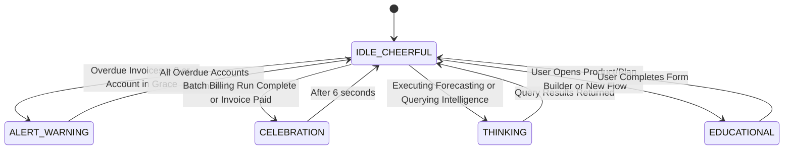

# PENNY THE FINANCIAL MASCOT: DESIGN & CONTEXTUAL SPECIFICATION
## The Retro-Modern Financial Companion of Brightloop

---

## 1. Character Identity & Brand Heritage

**Penny** is Brightloop's original orange coin mascot. Representing financial clarity, compound growth, and friendly precision, Penny transforms complex B2B subscription metrics into approachable, actionable guidance.

Rather than being a static cartoon graphic or a childish decoration, Penny is engineered as an **intelligent, contextual state machine** embedded into the interface. Penny speaks in the calm, considered tone of the Tokyo Studio aesthetic—concise, data-driven, and genuinely helpful.

```text
       ╭───────────────╮
    ╭──┤   ●     ●     ├──╮   "Good morning! Your MRR is pacing at
   │   │       ‿       │   │   ₹42.85L with 98.2% on-time settlement.
   │   ╰───────────────╯   │   3 invoices require your attention."
   │       ┌───────┐       │
   │       │   ₹   │       │
    ╰──────┴───────┴───────╯
```

---

## 2. Visual Anatomy & Design Tokens

Penny is constructed using clean, lightweight vector SVG and CSS animations, avoiding heavy media assets:

- **Primary Coin Body**: Circular coin geometry filled with vibrant warm amber `#FFA53B` and subtle metallic rim highlight `#F28D1A`.
- **Face & Expression**: Clean charcoal `#12191A` geometric eyes and mouth rendered with smooth SVG bezier arcs.
- **Center Insignia**: Embossed Indian Rupee symbol (`₹`) or cassette tape reel icon.
- **Micro-Shadow**: Soft diffused ambient drop shadow (`0 8px 24px -4px rgba(242, 141, 26, 0.28)`).
- **Proportions**: Compact 48px $\times$ 48px floating orb in the bottom-right viewport corner, expandable into a 320px contextual intelligence panel.

---

## 3. Penny's Emotional State Machine

Penny's visual expression and dialogue dynamically adapt to live financial state:



### State Specifications

| State | Visual Indicator | Mascot Animation | Example Contextual Dialogue |
| :--- | :--- | :--- | :--- |
| **`IDLE_CHEERFUL`** | Gentle bobbing, warm orange glow | Soft vertical floating ($\pm 3\text{px}$) | *"All recurring systems operational. Next billing batch due in 4 days."* |
| **`ALERT_WARNING`** | Amber pulsing border, alert badge | Pulsing glow, eyes widen | *"Watch out! Indus FinTech (₹1,45,000) is 3 days past due. UPI retry queued."* |
| **`CELEBRATION`** | Gold sparkle particles | Quick celebratory spin ($360^\circ$) | *"Batch billing complete! ₹38,65,000 invoiced across 142 accounts with zero duplicates."* |
| **`THINKING`** | Rotating cassette reels in eyes | Gentle horizontal swaying | *"Calculating cohort renewal confidence across top 20 enterprise tiers..."* |
| **`EDUCATIONAL`** | Pointer hand or blueprint grid | Attentive posture | *"Tip: Adding the Odoo Brand variant will add ₹560 directly to the plan's base price."* |

---

## 4. Contextual Intelligence Architecture

Penny is powered by an event-driven observer that listens to route changes and database telemetry:

```mermaid
graph TD
    UIEvent[User Navigation / Page Change] --> Observer[Penny Contextual Observer]
    DBTelemetry[Live Database Telemetry] --> Observer
    RoleContext[Active User Role: Admin / Staff / Customer] --> Observer

    Observer --> StateResolver{Resolve Page & Data Context}
    
    StateResolver -->|On Products Page| C1["Advise on Variant Price Offsets & Margin Simulator"]
    StateResolver -->|On Billing Page| C2["Show Due Subscriptions & Duplicate Protection Status"]
    StateResolver -->|On Customers Page| C3["Highlight At-Risk Accounts (Grace Periods)"]
    StateResolver -->|On Portal Page (Customer)| C4["Summarize Next Renewal Date & Downloadable Invoices"]
    
    C1 --> DialogueRenderer[Render Mascot Speech Bubble & Mood Animation]
    C2 --> DialogueRenderer
    C3 --> DialogueRenderer
    C4 --> DialogueRenderer
```

---

## 5. UI Integration & Interaction Patterns

1. **Floating Telemetry Pill (Bottom-Right)**:
   - Discreetly anchored at `bottom: 24px; right: 24px; z-index: 40`.
   - Displays Penny's animated face paired with a live status chip (e.g., `3 ACCOUNTS AT RISK`).
2. **Interactive Speech Bubble**:
   - On hover or click, an editorial popover expands (`#FFFFFF` background, `1px solid #E1E6E3` hairline border, Space Grotesk typography).
   - Contains:
     - Clear, humanized financial assessment.
     - 1-click action button (e.g., `Retry Failed UPI Now`, `View Expiring Discounts`).
     - Dismiss / minimize toggle so Penny never obstructs work.
3. **Mascot Preferences**:
   - Users can mute sound/chimes or minimize Penny into a minimal status light in the top header.

---

## 6. Demonstration Value for Hackathon Judges

Penny provides an unforgettable demonstration highlight:
- **Judges immediately smile**: The retro coin mascot breaks the monotony of generic enterprise forms.
- **Proves real database integration**: When a payment is recorded or an invoice is cancelled, Penny's expression and dialogue react in real time.
- **Demonstrates empathy for business users**: Complex accounting rules (like pro-rata billing or GST input credits) are explained simply by Penny.
