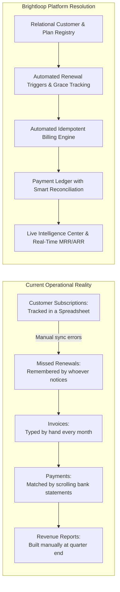
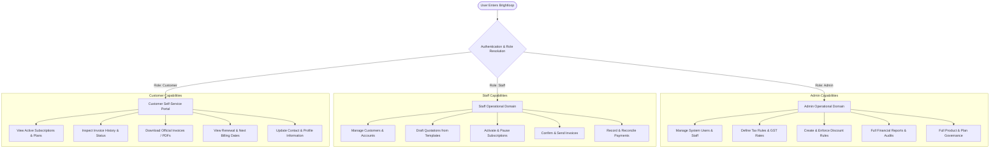

# PROJECT OVERVIEW — BRIGHTLOOP
## Unified Subscription Management & Recurring Revenue Engine

---

## 1. Product Vision & Mission

**Brightloop Software** is a high-velocity B2B subscription management SaaS platform designed to operate as the complete operational and financial digital backbone for companies that sell recurring products and services. 

In modern recurring businesses, revenue is not collected in single, disconnected transactions; it compounds monthly and yearly across contracts, add-ons, plan tiers, and metered usage. Traditional manual administration—relying on disconnected spreadsheets, calendar alerts, and manual invoice drafting—breaks down rapidly as customer volume grows. Missed renewals, erroneous duplicate invoices, untracked payments, and opaque revenue recognition erode margins and customer trust.

**Brightloop's mission** is to provide an end-to-end, zero-leakage recurring commerce engine that bridges every operational touchpoint:
1. Product and variant configuration with additive pricing.
2. Flexible billing cadences (Daily, Weekly, Monthly, Yearly).
3. Frictionless customer onboarding and self-service.
4. Fast quotation drafting and 1-click subscription conversion.
5. Automated, idempotent recurring invoice generation.
6. Unified tax and discount rule orchestration.
7. Multi-method payment reconciliation with dunning workflows.
8. Real-time executive financial telemetry with sub-2-second query performance.

---

## 2. Problem Statement Analysis (The Odoo Challenge)

The official **Odoo Subscription Management System** challenge presents a realistic scenario of **Brightloop Software**, a growing business suffering from five acute operational bottlenecks:

### Analysis of the Billing Month Scenes

1. **A New Customer Signs Up**:
   - Small businesses find Brightloop online, registering with unique email credentials.
   - Password security requires strict rules: $>8$ characters, at least one uppercase letter, one lowercase letter, and one special character.
   - System requires robust password recovery (email-based reset link).
   - Strict authorization boundaries: Customers must only view their personal subscriptions and billing history; staff have operational execution access; admins maintain total governance (including staff provisioning).

2. **Launching a New Plan**:
   - Brightloop introduces products with attributes: Name, Type (Service, SaaS, Add-on, Physical), Sales Price, Cost Price, and Notes.
   - Supports product variants with price modifications (e.g., selecting the *Odoo brand* adds ₹560 to the base price).
   - Plans support multiple frequencies: Daily, Weekly, Monthly, and Yearly.
   - Plans define minimum order quantities, start/end availability dates, and closure rules (automatic closure upon expiry vs. manual early closure, pause, or renewal).

3. **Turning a Quote into a Subscription**:
   - Sales reps draft offers for enterprise accounts using reusable quotation templates pre-populated with standard plan and product lines.
   - Quotations feature validity periods (valid for $N$ days).
   - Once accepted, quotes seamlessly transition into confirmed subscriptions with auto-assigned subscription numbers, payment terms, and calculated tax lines.
   - Subscription lifecycle states: **Draft $\rightarrow$ Quotation $\rightarrow$ Confirmed $\rightarrow$ Active $\rightarrow$ Closed**.

4. **Billing Day**:
   - When hundreds of subscriptions become due simultaneously, the system executes recurring billing automatically without manual intervention.
   - Invoices are generated directly from subscription contracts, pre-filling customer data, line items, variant pricing, taxes, and applied discounts.
   - Invoice lifecycle: **Draft $\rightarrow$ Confirmed $\rightarrow$ Paid**.
   - Strict duplicate billing prevention: Subscriptions must never be billed twice or skipped for the same billing period.

5. **A Customer Asks for a Better Price**:
   - Admins configure dynamic discount rules: Fixed amount or percentage discounts.
   - Rules support minimum purchase thresholds, minimum seat quantities, start and end validity dates, and lifetime usage limits.
   - Scope flexibility: Applicable to specific product lines or across the entire subscription.
   - Automatic application on the next scheduled invoice, self-terminating when expired or exhausted.

6. **The Money Comes In**:
   - Incoming payments arrive through diverse channels (UPI, Net Banking, Credit/Debit Cards, Bank Transfer, Offline Cheque).
   - Each transaction records payment ID, associated invoice, payment method, timestamp, amount, and notes.
   - Clear accounting visibility of paid, partially paid, and outstanding balances.
   - Immediate detection of overdue invoices to initiate smart dunning recovery before revenue is lost.

7. **The Finance Lead at Month-End**:
   - Instant answers to four critical financial questions:
     1. How many subscriptions are currently active?
     2. How much revenue was collected?
     3. How much revenue is outstanding or in transit?
     4. Which invoices are overdue and exposed to churn?
   - Strict performance requirement: **Every page must load and respond in under two seconds**, even under thousands of active subscriptions.

---

## 3. User Personas & Permissions Overview

---

## 4. Visual Identity & Design Principles

Brightloop adopts the **Google Stitch Studio Minimalist System** (Tokyo Studio aesthetic), combining clinical B2B SaaS precision with organic, tactile craftsmanship:

1. **Calm Warm Minimalism**:
   - Light canvas base (`#F8FAF9` / `#FBFBF9`) with porcelain card containers (`#FFFFFF`) and recessed wells (`#F3F5F4`).
   - Whisper-thin hairline borders (`#E1E6E3`) replace heavy elevation drops and drop-shadow clutter.
2. **Typographic Discipline**:
   - **Space Grotesk** for display headlines, navigational badges, and tabular numerical data.
   - **Plus Jakarta Sans / Geist** for crisp body text and form labels.
   - **JetBrains Mono / Space Mono** for financial codes, micro-labels (`OBJECT NO. 001`), and telemetry metrics.
3. **Intentional Botanical Accents**:
   - Deep seafoam/sage teal (`#2F7D72` / `#2B786C`) for primary CTAs, active status dots, and metric growth indicators.
   - Coral red (`#D95C68` / `#C85A65`) and warm amber (`#C98C2E`) reserved exclusively for dunning alerts, overdue warnings, and grace periods.
4. **Tactile Craftsmanship**:
   - Dual-mode Cassette switcher (`SIDE A · Dark` / `SIDE B · Light`) celebrating retro-modern analog engineering.
   - Micro-metadata annotations reflecting engineering blueprint aesthetics.

---

## 5. Hackathon Success & Judging Evaluation Criteria

Brightloop is architected to address the evaluation criteria of modern technical hackathons:

- **Completeness & Fidelity**: Implements 100% of the Odoo brief requirements without omissions or shortcuts.
- **Visual Distinction**: Seamlessly translates Google Stitch design files into a responsive, living application.
- **Architectural Soundness**: Enforces database-level foreign keys, unique constraint indexes for duplicate billing prevention, and ACID transaction safety.
- **Genuine Differentiator**: Delivers the **Financial Intelligence Center**, **Smart Revenue Forecaster**, and **Penny Contextual Assistant** as fully functioning tools rather than static visual mocks.
- **Speed & Usability**: Benchmark-tested sub-2-second response times backed by compound database indexing and efficient query plans.
