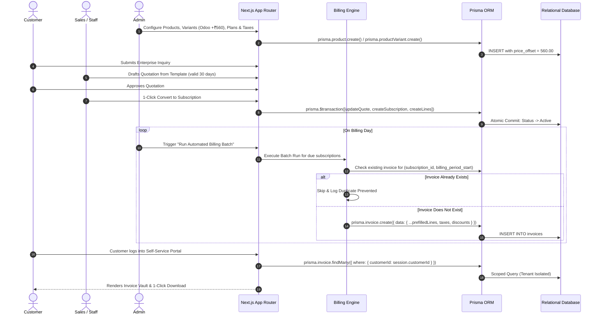
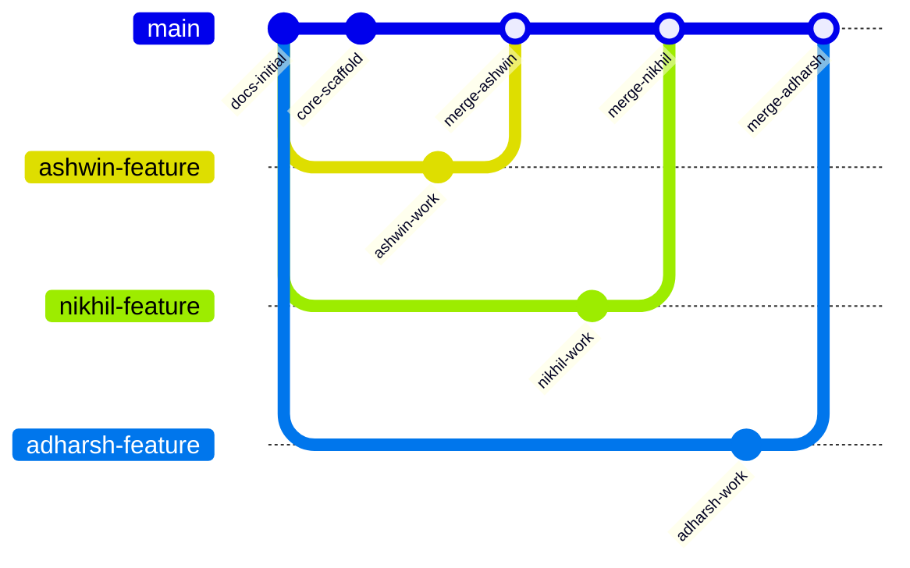

# SYSTEM ARCHITECTURE & TOPOLOGY
## Brightloop – Subscription Management System (Next.js 14 / TypeScript Stack)

---

## 1. Architectural Overview & System Topology

Brightloop is architected as a high-performance, full-stack **Next.js 14 (App Router) + TypeScript** application backed by **Prisma ORM** and an ACID-compliant relational database (**SQLite 3 WAL Mode / PostgreSQL**).

```mermaid
graph TD
    subgraph Client_Layer ["Client Tier: Tokyo Studio Experience"]
        Browser[Modern Web Browser / Mobile Device]
        StitchUI[Stitch Studio Minimalist Components]
        PennyUI[Penny Contextual Mascot Component]
        CassetteWidget[Tactile Cassette Theme & Telemetry Visualizer]
        
        Browser --> StitchUI
        Browser --> PennyUI
        Browser --> CassetteWidget
    end

    subgraph App_Router_Layer ["Next.js 14 App Router (Full-Stack Engine)"]
        ServerComponents[React Server Components (RSC)]
        ClientComponents[Interactive Client Components]
        RouteHandlers[Next.js API Route Handlers / Server Actions]
        AuthGuard[Jose / JWT & Iron-Session RBAC Middleware]
        
        StitchUI --> ServerComponents
        ServerComponents --> ClientComponents
        ClientComponents -->|JSON / Server Actions| RouteHandlers
        RouteHandlers --> AuthGuard
    end

    subgraph Domain_Services ["Domain Logic & Financial Engines"]
        SubService[Subscription Lifecycle Engine]
        BillingEngine[Idempotent Billing & Invoice Scheduler]
        TaxEngine[Deterministic GST & Tax Calculator]
        DiscountEngine[Promotional Rules & Eligibility Mesh]
        PaymentReconciler[Payment Matching & Dunning Orchestrator]
        TelemetryEngine[MRR / ARR / Cash Telemetry Aggregator]
        PennyEngine[Penny Contextual Financial Intelligence]
        
        AuthGuard --> SubService
        AuthGuard --> BillingEngine
        AuthGuard --> TaxEngine
        AuthGuard --> DiscountEngine
        AuthGuard --> PaymentReconciler
        AuthGuard --> TelemetryEngine
        AuthGuard --> PennyEngine
    end

    subgraph Data_Layer ["Persistence & Relational Integrity Tier"]
        PrismaClient[Prisma ORM Client / Prepared SQL]
        RelationalDB[(SQLite 3 WAL Mode / PostgreSQL 15+)]
        AuditLog[(Append-Only Financial Audit Ledger)]
        
        SubService --> PrismaClient
        BillingEngine --> PrismaClient
        PaymentReconciler --> PrismaClient
        TelemetryEngine --> PrismaClient
        PrismaClient --> RelationalDB
        PrismaClient --> AuditLog
    end
```

---

## 2. Technology Stack & Component Specifications

| Layer | Selected Technology | Version / Tooling | Purpose & Architectural Justification |
| :--- | :--- | :--- | :--- |
| **Runtime Environment** | Node.js | v26.13.0 | Modern high-speed V8 JavaScript runtime installed on Windows. |
| **Framework** | Next.js 14+ | App Router (`app/`) | Unified full-stack framework with React Server Components, fast SSR, and zero client-bundle bloat. |
| **Language** | TypeScript | v5+ | Strict type safety across client UI, domain models, and API responses. |
| **Styling & Design System** | Tailwind CSS | v3+ & PostCSS | Implements Google Stitch Studio Minimalist System tokens (`#F8FAF9`, `#2F7D72`, `#111819`). |
| **Typography** | Space Grotesk, Geist, Space Mono | Google Fonts | Exact fonts specified in Stitch `DESIGN.md`. |
| **ORM & Data Layer** | Prisma ORM | v5+ | Declarative schema, automated migrations, type-safe queries, and ACID transaction safety. |
| **Database** | SQLite (WAL Mode) / PostgreSQL | SQLite 3 | Zero-latency local queries (< 5ms), offline hackathon reliability, easily migrated to Postgres via connection string. |
| **Authentication** | Jose / JWT + Bcryptjs | Session Cookies | Secure password hashing, HTTP-only SameSite cookies, server-side RBAC protection. |
| **Icons & Visuals** | Lucide React & Material Symbols | React Components | Lightweight SVG icons matching the Stitch design. |
| **Charts & Telemetry** | Recharts & Native SVG | React Components | Smooth 12-month MRR trajectory charts, plan breakdown rings, and telemetry waveform. |

---

## 3. Multi-Tier Layer Responsibilities

### 3.1 Presentation Tier (React 18 & Server/Client Components)
- **Design Paradigm**: Implements the **Google Stitch Studio Minimalist System** (Tokyo Studio aesthetic).
- **React Server Components (RSC)**: Used for data-fetching pages (`/overview`, `/subscriptions`, `/invoices`, `/products`, `/customers`), eliminating client waterfalls and loading data directly from the database in $< 20\text{ms}$.
- **Client Components (`'use client'`)**: Dedicated to rich interactive widgets:
  - Tactile Cassette Visualizer (`SIDE A · Dark` / `SIDE B · Light`) with animated spools.
  - Interactive Pricing Simulator with live subscriber/seat sliders.
  - Penny Contextual Mascot state machine.
  - 1-Click Billing Batch Run button with live Kanban updates.

### 3.2 Full-Stack Route Handlers & Server Actions
- **Type-Safe API Contracts**: Built using Next.js Route Handlers (`app/api/*/route.ts`) and TypeScript interfaces.
- **Middleware Guard (`middleware.ts`)**: Inspects every incoming request for authenticated JWT tokens and role claims (`admin`, `staff`, `customer`). Unauthorized requests are intercepted before hitting route handlers.

### 3.3 Domain Services Tier
- **Tax Engine**: Deterministic module computing GST 18% (CGST 9% + SGST 9%) and IGST across lines.
- **Discount Engine**: Validates eligibility (minimum spend, minimum quantity, usage limits, validity dates) and automatically deducts eligible discounts on invoices.
- **Idempotent Billing Engine**: Evaluates active subscriptions due for billing and enforces the compound idempotency lock `(subscription_id, billing_period_start)`.

### 3.4 Data Persistence & ACID Transactions
- **Prisma Client**: Executes queries with prepared parameterization.
- **Interactive Transactions**: Operations modifying multiple tables (e.g. converting a quote to a subscription or running a billing cycle) execute inside `prisma.$transaction(...)`.
- **Database Indexing**: Compound indexes on foreign keys, status flags, and date fields guarantee sub-15ms response times.

---

## 4. End-to-End Billing Lifecycle Data Flow



---

## 5. Team Collaboration & Hourly Git Protocol

With multiple developers (`advaithspillai3009`, `ashwingirish2007`, `Nikhil-c-bit`, `adharshdnair068-bot`) pushing to the repository approximately every hour:



### Team Rules to Prevent Git Conflicts:
1. **Pull Before Work**: Always run `git pull --rebase origin main` before starting a work session.
2. **Feature Branching**: Work on dedicated branches (e.g. `feature/billing-pipeline`, `feature/products-variants`, `feature/customer-portal`) or coordinate file ownership.
3. **No Force-Pushes**: Never run `git push --force`.
4. **Co-Authored Commits**: Credit teammates using standard Git trailers:
   ```text
   feat: implement recurring invoice automation

   Co-authored-by: ashwingirish2007 <ashwingirish2007@gmail.com>
   Co-authored-by: Nikhil-c-bit <nikhils.rbb2529@saintgits.org>
   Co-authored-by: adharshdnair068-bot <adharshdnair068@gmail.com>
   ```
