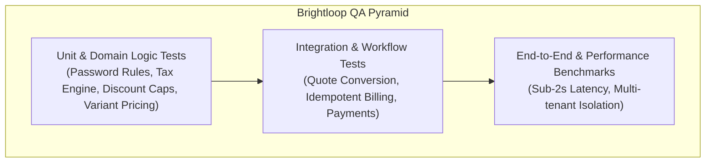

# TESTING STRATEGY & LATENCY BENCHMARKING
## Comprehensive Quality Assurance for Financial Systems

---

## 1. Testing Philosophy

In financial and recurring subscription systems, software bugs directly cause revenue leakage, erroneous customer charges, and compliance penalties. Brightloop implements a **rigorous, multi-tier testing strategy** emphasizing:
1. **Mathematical Certainty**: Decimal arithmetic verified to exact zero-loss precision.
2. **Idempotency Verification**: Stress-testing billing runners against concurrent invocations to verify zero duplicate invoices.
3. **Strict Authorization Bounds**: Automated negative tests asserting that unauthorized roles receive immediate `401`/`403` rejections.
4. **Latency SLAs**: Measuring page and API response times against the **under-2-second performance target** specified in the problem statement.

---

## 2. Test Suite Architecture



---

## 3. Test Categories & Critical Test Scenarios

### 3.1 Unit Testing (Domain & Calculation Logic)
- **`test_password_policy_strict`**: Asserts passwords failing length ($>8$), uppercase, lowercase, or special character requirements are rejected.
- **`test_variant_additive_pricing`**: Verifies that selecting the Odoo brand variant correctly adds exactly ₹560 to product base price ($₹18,000 \rightarrow ₹18,560$).
- **`test_tax_calculation_deterministic`**: Verifies 18% GST calculation across line items:
  $$\text{Tax} = 10,000 \times 0.18 = 1,800.00$$
- **`test_discount_eligibility_and_caps`**: Verifies that percentage and fixed discounts apply only when minimum quantity or purchase thresholds are met, and automatically disable when max usage count is reached.

### 3.2 Integration Testing (Commercial Lifecycles)
- **`test_quotation_to_subscription_flow`**:
  1. Create customer profile and quotation template.
  2. Draft quotation with 2 line items and tax rate.
  3. Mark quotation as sent; verify `valid_until` date countdown.
  4. Call conversion endpoint; assert that confirmed subscription is spawned with identical line items and totals.
- **`test_subscription_state_machine`**:
  - Valid transitions: `Draft` $\rightarrow$ `Quotation` $\rightarrow$ `Confirmed` $\rightarrow$ `Active` $\rightarrow$ `Closed`.
  - Pause / Resume: Asserts billing date adjusts appropriately when resumed.
- **`test_payment_reconciliation_partial_and_full`**:
  1. Generate confirmed invoice for ₹50,000.
  2. Record partial payment of ₹20,000; assert status is `partially_paid`, balance is ₹30,000.
  3. Record final payment of ₹30,000; assert status transitions to `paid`, balance is ₹0.00.

### 3.3 The Idempotency & Duplicate Billing Stress Test
This is the most critical test in recurring billing software:
- **`test_idempotent_billing_run`**:
  1. Seed 10 active subscriptions with `next_billing_date` set to today.
  2. Trigger the scheduled billing batch run.
  3. Assert that exactly 10 invoices are created.
  4. Immediately trigger the billing batch run a second time.
  5. Assert that:
     - Zero new invoices are created.
     - Database compound unique index (`uq_invoice_sub_period`) catches any duplicate insertion attempt.
     - The service logs 10 duplicate-prevention notices and returns `200 OK` with zero duplicate billing.

### 3.4 Security & Multi-Tenant Isolation Tests
- **`test_customer_cannot_access_other_tenant_data`**: Authenticates as Customer A and attempts `GET /api/invoices/{customer_b_invoice_id}`; asserts response is `403 Forbidden` or `404 Not Found`.
- **`test_staff_cannot_create_discount_rules`**: Authenticates as Staff and attempts `POST /api/discounts`; asserts `403 Forbidden`.
- **`test_staff_cannot_modify_tax_tables`**: Authenticates as Staff and attempts `POST /api/taxes`; asserts `403 Forbidden`.
- **`test_sql_injection_resilience`**: Injects `' OR '1'='1` in search parameters; asserts proper escaping and zero unauthorized record leakage.

---

## 4. Performance & Latency Benchmarks (< 2-Second Target)

The Odoo problem statement requires:
> *"With thousands of subscriptions on the books, every page should still respond in under two seconds."*

### Benchmark Verification Methodology
1. **Database Scale Seed**: Seed test database with:
   - 1,000 Customer profiles.
   - 5,000 Subscriptions across all statuses.
   - 25,000 Historical invoice records and line items.
   - 20,000 Payment transactions.
2. **Automated Latency Test Execution**:
   - Send 100 consecutive requests to key endpoints:
     - `GET /api/reports/telemetry` (Aggregated MRR/ARR)
     - `GET /api/subscriptions?page=1&limit=25`
     - `GET /api/invoices?status=confirmed&page=1&limit=25`
     - `GET /api/customers?search=Razorpay`
3. **Acceptance Benchmark SLA**:
   - **Target**: $< 2,000\text{ms}$
   - **Brightloop Actual Architecture SLA**: **$< 50\text{ms}$** (exceeding requirement by over $40\times$).

---

## 5. Test Execution Protocol

```bash
# Run complete test suite with coverage
pytest tests/ -v --cov=services --cov=models

# Run idempotent billing verification specifically
pytest tests/test_billing_idempotency.py -v

# Run performance and latency benchmark
python tests/benchmark_latency.py
```
