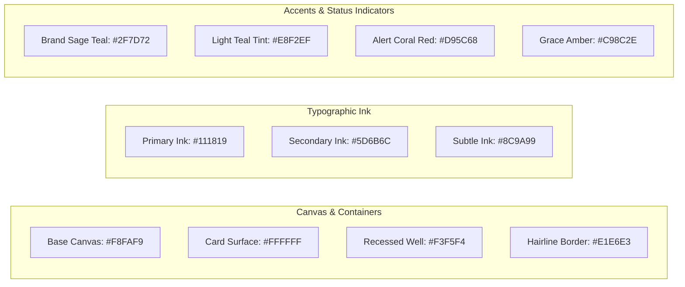
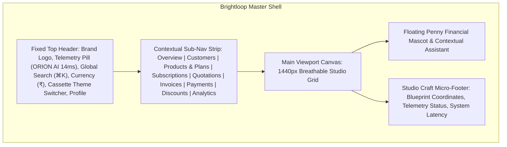

# UI/UX IMPLEMENTATION GUIDE
## Tokyo Studio Minimalist System & Stitch Integration

---

## 1. Design System Overview & Philosophy

Brightloop's interface directly implements the **Google Stitch Studio Minimalist System** (detailed in `studio_minimalist_system/DESIGN.md`). The aesthetic merges **Japanese editorial craftsmanship** with **calm, tactile SaaS engineering**.

### Core Visual Tenets
1. **Calm Warm Minimalism**: A tranquil, off-white canvas (`#F8FAF9` / `#FBFBF9`) paired with subtle botanical-mineral undertones rather than clinical, stark gray neutrals.
2. **Editorial Typographic Precision**: Strict typographic hierarchy with wide tracking on technical micro-labels (`label-code`: `+0.12em`), tight tracking on large display headings (`-0.02em` to `-0.03em`), and monospace catalog markers (`OBJECT NO. 001`, `35°40' N 139°45' E`).
3. **Subtle Organic Accents**: Deep seafoam/sage teal (`#2F7D72` / `#2B786C`) applied deliberately to primary action triggers, live availability status lights, and statement typography.
4. **Restrained Depth & Elevation**: Elimination of heavy drop shadows and exaggerated blur filters. Depth is established through subtle surface shifts (nested `#F3F5F4` containers) and low-contrast hairline borders (`1px solid #E1E6E3`).

---

## 2. Design Tokens & Styling Constants

### 2.1 Color Palette

### 2.2 Typography Scale

| Token | Font Family | Size | Weight | Line Height | Tracking | Purpose |
| :--- | :--- | :--- | :--- | :--- | :--- | :--- |
| `display-hero` | Space Grotesk | 64px | 700 Bold | 72px | `-0.03em` | Hero editorial headlines |
| `headline-lg` | Space Grotesk | 44px | 700 Bold | 52px | `-0.02em` | Primary page module headers |
| `headline-md` | Space Grotesk | 32px | 600 SemiBold | 40px | `-0.015em` | Major KPI numerical totals |
| `headline-sm` | Space Grotesk | 24px | 600 SemiBold | 32px | `-0.01em` | Section card headers |
| `body-md` | Plus Jakarta / Geist | 15px | 400 Regular | 24px | `0em` | Standard running text & forms |
| `body-sm` | Plus Jakarta / Geist | 13px | 400 Regular | 20px | `0em` | Table rows & auxiliary text |
| `label-code` | Space Mono / JetBrains | 11px | 500 Medium | 16px | `+0.12em` | Uppercase technical markers & stamps |
| `label-nav` | Space Grotesk | 14px | 500 Medium | 20px | `+0.01em` | Top navigation items |
| `label-btn` | Space Grotesk | 14px | 600 SemiBold | 20px | `+0.02em` | Interactive buttons & pills |

---

## 3. Application Shell & Navigation Layout

The application utilizes a cohesive, single-app container that binds all functional modules:

### Distinctive Header Elements
1. **Brand Mark**: `brightloop / software ®` with sage teal slash accent and registered subscript.
2. **ORION AI Telemetry Pill**: Glowing sage teal status light (`#2F7D72` pulse) with `ORION AI // ACTIVE | LATENCY 14ms`.
3. **Command Palette (`⌘K`)**: Instant search for subscriptions, accounts, and invoices.
4. **Tactile Cassette Switcher**: Interactive miniature audio cassette icon toggling `SIDE B · Light` and `SIDE A · Dark`.

---

## 4. Screen-by-Screen Implementation Mapping

### 4.1 Overview & Financial Intelligence Center
*Source Reference: `brightloop_software_ai_subscription_management_platform_light_mode/code.html`*
- **Left Hero Column**: Typographic display statement ("Predictable scale. Built to compound.") with primary action triggers (`Deploy New Subscription ↗`, `Run automated dunning →`).
- **Right Hero Column**: `OBJECT NO. 001` - Realistic tactile Cassette visualizer with spinning spools displaying live `MRR PACING (₹42,85,000)`. Includes Natural Language query bar and proactive AI insight cards.
- **KPI Ribbon**: 6 precision telemetry cards:
  1. Active Subscriptions ($1,428$ / $+12.4\%$)
  2. Contracted MRR ($₹42,85,000$ / $+14.2\%$)
  3. ARR Run-Rate ($₹5,14,20,000$ / $+18.6\%$)
  4. Total Customers ($894$ / $+8$ new)
  5. Pending Settlements ($₹6,45,000$ / $14$ Invoices)
  6. Overdue Invoices ($₹2,10,000$ / $3$ Accounts in Grace)
- **Visual Analytics Waveform**: 12-month MRR trajectory SVG chart with milestone markers and plan composition distribution.
- **Live Recurring Ledger**: Detailed table with customer health scores ($0-100$) and status indicators (`Active`, `In Grace`, `In Dunning`).

### 4.2 Products, Plans & Pricing Architecture
*Source Reference: `brightloop_software_products_plans_light_mode/code.html`*
- **Tier Matrix**: Starter Core ($₹6,500/\text{mo}$), Growth Tier ($₹18,000/\text{mo}$), Scale Automation ($₹45,000/\text{mo}$), and Enterprise Custom ($₹1,50,000+/\text{mo}$).
- **Variant Configuration**: Additive brand pricing selector demonstrating the **Odoo Brand** offset ($+₹560$).
- **Interactive Pricing Simulator**: Real-time slider adjusting subscriber base and seats to calculate monthly contribution and margin percentage ($\sim 82.4\%$).
- **Modular Add-ons Table**: Metered overages and decoupled microservice components (e.g., GST e-Invoicing Connector, Global FX).
- **Active Promotional Rules Grid**: Visual coupon cards (`ANNUAL25`, `FINTECH_ACCEL`) displaying redemptions and elapsed savings.

### 4.3 Subscriptions Ledger & Recurring Lifecycle
*Source Reference: `brightloop_software_subscriptions_ledger_light_mode/code.html`*
- **Contract Ledger**: Filter rail supporting instant search, plan tier filtering, billing cycle toggling, and status segmentation (`Active`, `In Grace`, `In Dunning`, `Paused`, `Closed`).
- **Interactive Lifecycle Actions**: 1-click controls to Pause, Resume, Renew, Scale Quota, or trigger automated dunning retries.
- **Audit Drawer**: Side-sheet sliding in to reveal chronological state changes and acting user timestamps.

### 4.4 Invoices, Quotations & Billing Settlements
*Source Reference: `brightloop_software_invoices_billing_light_mode/code.html`*
- **Dunning Warning Banner**: Highlighting exposed accounts past due with 1-click batch dunning trigger.
- **Settlement KPI Ribbon**: Monthly Collections, In-Transit Clearance, GST Input Credits, and Overdue Recovery.
- **Quotation Builder**: Drawer to compose new proposals with auto-populated lines and validity countdown.
- **GST Invoice Actions**: Actions to Confirm, Cancel, Send via email, and download printable PDF tax invoices with QR code simulation.

### 4.5 Customer Accounts & Enterprise Directory
*Source Reference: `brightloop_software_customers_accounts_light_mode/code.html`*
- **Enterprise Directory Table**: 894 tracked accounts displaying ARR contribution, contact leads, GSTIN numbers, and AI health metrics.
- **Customer Detail Sheet**: 360-degree drawer detailing contracted subscriptions, historic invoices, and payment ledger.

### 4.6 Customer Self-Service Portal
*Extended Studio Aesthetic View*
- Dedicated customer workspace displaying their company's active subscriptions, next billing dates, invoice vault with 1-click PDF download, and payment method details.

---

## 5. Reusable Component Inventory

1. **Button System**:
   - `Primary`: Solid charcoal `#12191A`, text `#FFFFFF`, 6px border radius, inline arrow glyph (`↗`), hover state `#232F30`.
   - `Secondary`: Clean white `#FFFFFF`, border `#E1E6E3`, text `#111819`, hover border `#2F7D72`.
   - `Danger / Alert`: Red container `#FFDAD6`, text `#93000A`, hover bg `#BA1A1A` with white text.
2. **Status Badges & Indicator Dots**:
   - `Active / Paid`: Background `rgba(47, 125, 114, 0.1)`, text `#2F7D72`, pulsing green dot.
   - `In Grace / Pending`: Background `rgba(201, 140, 46, 0.1)`, text `#C98C2E`, amber indicator.
   - `Overdue / Critical`: Background `rgba(217, 92, 104, 0.1)`, text `#D95C68`, coral dot.
3. **Data Tables**:
   - Fixed header with uppercase monospaced labels (`Space Mono`, 11px).
   - Alternating hover row highlighting (`#F8FAF9`), right-aligned numeric currencies.
   - Integrated pagination strip showing record counts and page jump controls.
4. **Drawers & Modals**:
   - Slide-over right drawer for editing subscriptions and quotations without losing page state.
   - Accessible dialog modals for confirmation of destructive operations (cancellations, deactivations).
