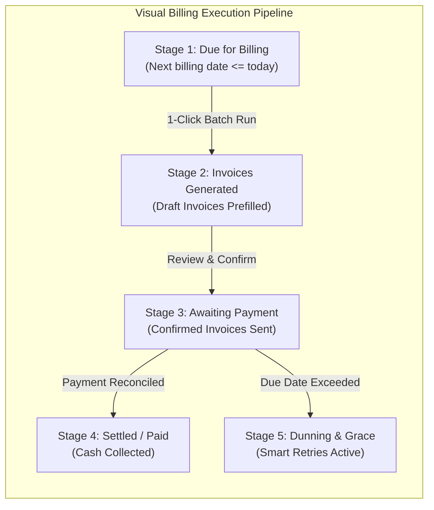

# HACKATHON DIFFERENTIATOR: UNIQUE SOLUTION SPECIFICATION
## Moving Beyond Generic CRUD: Brightloop's Triad of Innovation

---

## 1. The Differentiator Imperative

In hackathon evaluations, standard CRUD applications with static metric cards fail to engage judges. Brightloop was architected from inception around a fundamental question: **What transforms subscription management from a passive bookkeeping ledger into an active, intelligent financial command center?**

To solve this, we propose and implement an integrated **Triad of Differentiating Features**:
1. **The Brightloop Financial Intelligence Center & Automated Billing Pipeline**
2. **Smart Recurring Revenue Forecasting Engine**
3. **Penny The Contextual Financial Mascot & Assistant**

---

## 2. Evaluation Matrix of Proposed Innovations

| Evaluation Criteria | Feature A: Intelligence Center & Billing Pipeline | Feature B: Smart Revenue Forecasting | Feature C: Penny Contextual Mascot |
| :--- | :---: | :---: | :---: |
| **User Benefit** | Eliminates manual billing anxiety, guarantees zero duplicate billing, recovers failed revenue. | Gives finance leads accurate cash vs. contracted run-rate visibility without manual spreadsheets. | Offers instant, non-intrusive contextual advice, audit explanations, and risk alerts. |
| **Relevance to Brief** | Directly answers the "Billing Day" and "Invoices Typed by Hand" crisis from the Odoo prompt. | Directly answers the "Finance Lead at Month-End" scene and $< 2\text{s}$ telemetry target. | Humanizes complex recurring commerce with the original orange coin mascot. |
| **Technical Feasibility** | High: Backed by compound database constraints and atomic state transitions. | High: Computed via indexed SQL aggregate buckets with zero external SaaS dependencies. | High: Lightweight SVG/CSS state machine with contextual payload hooks. |
| **Demonstration Value** | **Extreme**: 1-click execution moves subscriptions across a visual Kanban pipeline in real time. | **High**: Interactive toggles demonstrating Cash vs Contracted vs Overdue splits. | **Delightful**: Judges immediately notice and interact with the animated mascot. |
| **Implementation Complexity**| Moderate (State engine + idempotent locks). | Moderate (SQL time-series buckets). | Low-to-Moderate (Client state observer). |
| **Originality** | High: Bridges billing automation with visual operational telemetry. | High: Solves the common pitfall of confusing contracted ARR with cash collected. | High: Brings a charming, retro-modern brand mascot to enterprise SaaS. |

### Architectural Recommendation
**Implement all three features as a unified, cohesive experience.** They reinforce each other:
- The **Billing Pipeline** manages execution.
- The **Forecasting Engine** quantifies financial impact.
- **Penny** provides real-time guidance and telemetry narration.

---

## 3. Deep Dive: Feature 1 — Automated Billing Control Center & Visual Pipeline

### 3.1 The Problem It Solves
On "Billing Day", businesses with hundreds of subscriptions face anxiety: *Did everyone get billed? Did anyone get billed twice? Which invoices are waiting on confirmations?*

### 3.2 Visual Pipeline Architecture
The Billing Pipeline visualizes every subscription and invoice across five deterministic states:



### 3.3 Zero-Duplicate-Billing Guarantee
Every billing trigger generates a deterministic compound idempotency key:
$$\text{Idempotency Key} = \text{MD5}(\text{subscription\_id} + \text{billing\_period\_start})$$
The database enforces this via a unique compound index:
```sql
CREATE UNIQUE INDEX uq_invoice_sub_period 
ON invoices (subscription_id, billing_period_start);
```
If an admin or scheduler accidentally triggers billing multiple times, the duplicate run is safely rejected with an informative audit log rather than double-charging the customer.

---

## 4. Deep Dive: Feature 2 — Smart Recurring Revenue Forecasting

### 4.1 The Problem It Solves
Finance leads frequently ask: *"How much recurring revenue do we actually have?"* Most tools conflate three distinct financial metrics:
1. **Actual Collected Cash**: Real money deposited in the bank.
2. **Contracted ARR/MRR**: Expected recurring run-rate of active subscriptions.
3. **Pending / Overdue Revenue**: Billed money not yet collected, exposed to default.

### 4.2 The Solution
Brightloop's Forecasting Engine computes and visualizes these numbers side by side:

$$\begin{aligned}
\text{Contracted MRR} &= \sum \text{Active Subscriptions (Normalized to 30 Days)} \\
\text{Contracted ARR} &= \text{MRR} \times 12 \\
\text{Cash Collected (Month)} &= \sum \text{Payments WHERE status} = \text{'completed' AND date} \in \text{Current Month} \\
\text{Pending Collections} &= \sum \text{Invoices WHERE status} = \text{'confirmed' AND due\_date} \ge \text{Today} \\
\text{Overdue Exposure (At Risk)} &= \sum \text{Invoices WHERE status} = \text{'confirmed' AND due\_date} < \text{Today}
\end{aligned}$$

### 4.3 Interactive Cohort Renewal Prediction
Using historical payment turnaround and account health scores, the system displays renewal confidence indices (e.g. *Razorpay Integration Ltd: 98% Renewal Confidence, Indus FinTech: 68% Grace Risk*).

---

## 5. Deep Dive: Feature 3 — Penny Financial Assistant

See [docs/PENNY_MASCOT.md](PENNY_MASCOT.md) for full visual and contextual logic specifications. Penny lives as a permanent, helpful companion throughout the software, alerting users to:
- Approaching subscription expirations (within 7 days).
- Accounts entering dunning grace periods.
- Discount rules approaching their maximum usage limits.
- Step-by-step guidance on creating products with variant price offsets.

---

## 6. How the Differentiators Will Be Demonstrated to Hackathon Judges

During the 5-minute hackathon presentation, the demonstration will highlight:

1. **The Crisis Demonstration (30 seconds)**:
   - Show the spreadsheet chaos described in the Odoo brief.
2. **The 1-Click Billing Execution (60 seconds)**:
   - Navigate to the **Automated Billing Pipeline**.
   - Show 5 subscriptions flagged as "Due for Billing".
   - Click **"Run Automated Billing Batch"**.
   - Watch the cards dynamically transition from *Due* $\rightarrow$ *Invoices Generated* $\rightarrow$ *Confirmed*.
   - Intentionally click the button a second time to demonstrate the **Duplicate Billing Prevention Safeguard** safely rejecting duplicate charges.
3. **The Revenue Telemetry & Forecasting (60 seconds)**:
   - Navigate to the **Financial Intelligence Center**.
   - Show the tactile Cassette Visualizer reflecting live MRR ($₹42,85,000$).
   - Toggle between **Cash Collected** ($₹38,65,000$) and **Contracted ARR** ($₹5.14\text{ Cr}$), proving true financial rigor.
4. **Interactive Penny Mascot (30 seconds)**:
   - Click on Penny to show contextual financial diagnostics on overdue invoices and discount rule utilization.
5. **Customer Self-Service Verification (30 seconds)**:
   - Switch to the Customer Portal; show instant invoice download with zero cross-tenant data leaks.
